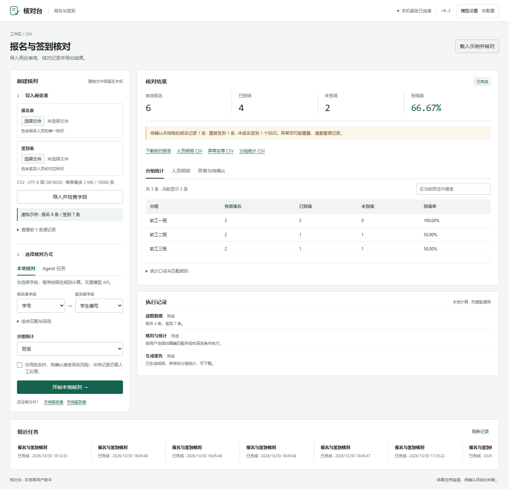
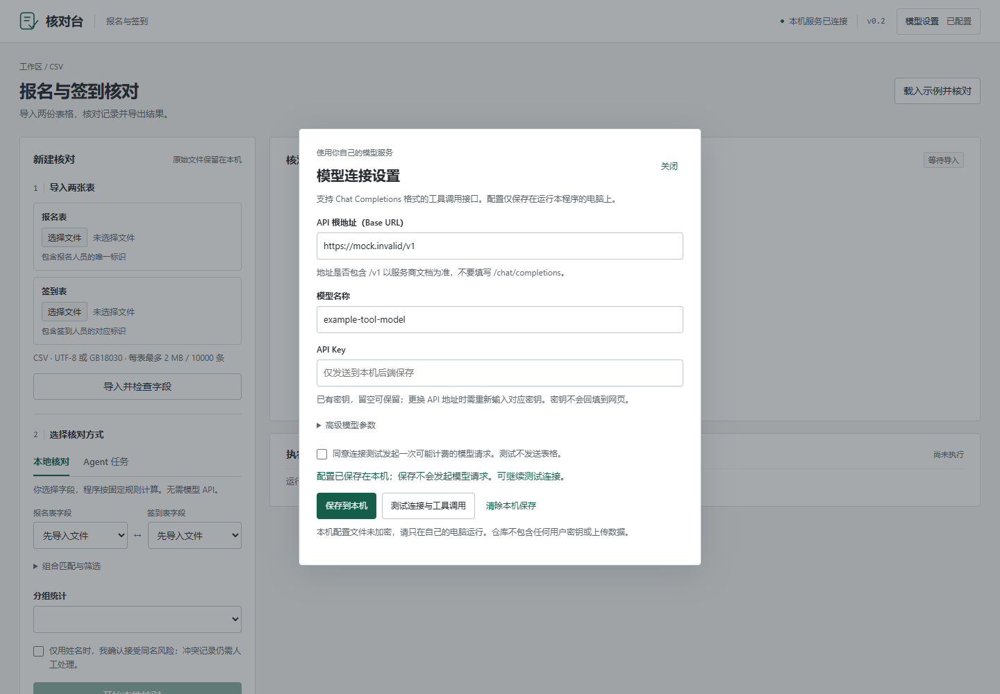
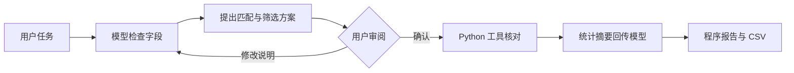
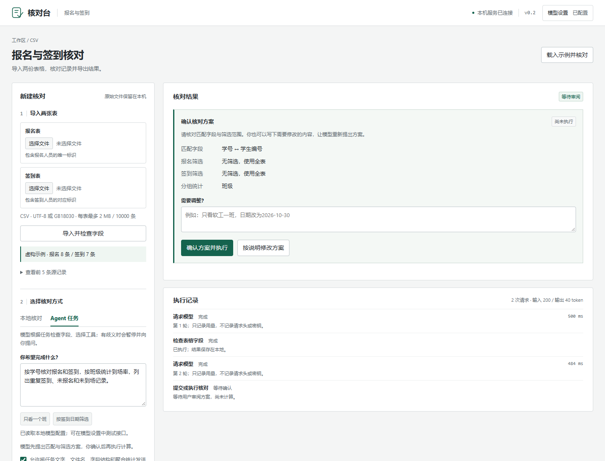

# 核对台 · Table Report Agent

报名表、签到表的核对工作台。使用 Python 进行可追溯的计算，使用可选的模型工具调用理解任务，并在执行前让用户审阅匹配与筛选方案。

适用于活动组织、课程助教、小团队名单核对。支持自带模型 API（BYOK），无需配置 API 也能运行本地核对。



## 能完成什么

- **精确核对**：单字段或复合字段匹配，保留前导零，识别未到场和未报名签到。
- **异常检查**：重复报名、重复签到、空标识、冲突标识分别记录，异常项可追溯至源记录。
- **筛选与分组**：按字段精确筛选、按班级或部门汇总，计算口径明确。
- **自然语言任务**：模型检查字段、提出方案、必要时追问；用户确认方案后执行。
- **自己的 API**：在设置中填写 Base URL、模型标识、API Key，显式测试连接与工具调用。
- **交付与记录**：Markdown 报告、三种 CSV、SQLite 历史、工具事件、错误和 token 用量。

## 快速运行

需要 **Python 3.11+**，无 Node.js 或前端构建依赖。

```bash
git clone https://github.com/Whitersir/table-report-agent.git
cd table-report-agent
python -m venv .venv
```

Windows PowerShell：

```powershell
.\.venv\Scripts\python.exe -m pip install -r requirements.txt
.\.venv\Scripts\python.exe run.py
```

macOS / Linux：

```bash
.venv/bin/python -m pip install -r requirements.txt
.venv/bin/python run.py
```

打开 **http://127.0.0.1:8765**，点击“载入示例并核对”。预期：有效报名 **6**，到场 **4**，未到场 **2**，到场率 **66.67%**。这个流程不调用模型，示例为虚构数据。

Windows 安装依赖后也可以双击 `start.cmd`。终端按 Ctrl+C 停止服务。端口冲突时使用 `run.py --port 8769`，不要同时启动使用同一数据目录的多个实例。

## 配置自己的模型

1. 点击右上角“模型设置”。
2. 填写 API 根地址、精确模型名称和自己的 API Key。
3. “保存到本机”不会发起模型请求。勾选确认后，可点击“测试连接与工具调用”；该测试发起一次可能计费的请求，不发送表格。
4. 导入文件，切换“Agent 任务”，输入要求并确认发送范围。
5. 审阅模型提出的匹配字段、筛选条件与分组方式。确认后执行，也可要求修改方案。



支持 **Chat Completions + function tools** 格式。Base URL 不包含 `/chat/completions`，是否含 `/v1` 以服务商文档为准。仅提供 Responses、Anthropic Messages 或非标准工具格式的服务需要另写适配。

页面保存于服务端 `data/model-settings.json`，不写入浏览器 localStorage/sessionStorage，不通过查询接口回传密钥。文件未加密，适用于自己的本机；更换 API 地址时需重新输入对应密钥。

也支持 `.env.example` 中列出的环境变量。优先级为：**进程环境变量 → 页面保存的本机设置 → 项目 .env**。清除页面保存不会删除其他配置来源。

## Agent 的职责与边界

固定报表使用本地方式即可。模型的作用是把不同的自然语言要求转成工具参数，并根据字段或错误反馈选择下一步；匹配、去重、计算和报告数字仍由程序完成。



四个工具：`inspect_tables`、`reconcile_attendance`、`summarize_by_group`、`ask_user`。工具名采用允许列表，参数由 Pydantic 校验；模型不能执行任意代码或读取其他文件。未计算就宣告完成会被判为失败，未审阅的方案不能生成最终下载。



每个任务最多 10 轮调用，请求超时 45 秒。失败保留任务和事件记录，用户可显式重试；不自动循环重试。统计报告由程序模板生成，模型最终文字不作为数字来源。

## 数据格式与统计口径

首版支持逗号分隔 CSV，编码为 UTF-8、UTF-8 BOM 或 GB18030。Excel 请先另存为 CSV UTF-8。每表最多 2 MB、10000 条非空记录、50 列；列名唯一且非空。

| 情况 | 处理方式 |
|---|---|
| 学号 `001` 与 `1` | 不视为相同标识；单元格始终保留字符串 |
| 完全相同的重复报名 | 只计一人，保留全部来源记录 |
| 同标识、不同报名内容 | 标为冲突，排除并交给人工确认 |
| 空标识 | 不互相匹配，不计入有效报名分母 |
| 仅用姓名 | 需用户确认风险，重复姓名仍保留歧义 |
| 重复签到 | 只计一次到场，额外记录单列异常 |
| 筛选范围外的报名人签到 | 与“未报名签到”区分 |
| 有效报名为零 | 到场率不适用，不产生除零错误 |

到场率 = 匹配到签到的有效报名人数 / 有效报名人数，四舍五入至两位。筛选为精确字符串相等，不支持日期区间或模糊姓名匹配。Excel 若已丢失学号前导零，程序不能恢复。

记录号指 CSV 记录序号（表头为 1），含换行单元格时不同于文本行号。页面每类最多预览 200 条，搜索限当前预览；下载包含全部结果。

## 架构与检查

| 模块 | 实现 |
|---|---|
| 输入与业务 | Python csv、精确键匹配、Decimal 百分比 |
| 服务与校验 | FastAPI、Pydantic |
| 模型适配 | httpx、Chat Completions function tools |
| 持久化 | SQLite + 本地原始文件副本 |
| 界面 | HTML、CSS、原生 JavaScript，无框架构建步骤 |

```bash
python -m pip install -r requirements-dev.txt
python -m pytest -q
python scripts/evaluate.py
python scripts/browser_check.py
python scripts/browser_agent_check.py
```

以上 `python` 指虚拟环境解释器。Windows 浏览器检查默认使用 Edge；其他系统先运行 `python -m playwright install chromium`。

**目前验证情况**：业务/API/模型模拟测试、本机浏览器交互、12 个带人工预设答案的合成业务场景已实际检查。详见 [检查结果](docs/检查结果.md) 与 [业务评测记录](evaluations/latest.json)。GitHub Actions 配置为对 Python 3.11/3.12、Windows/Linux 运行测试，并在 Linux 检查浏览器流程。

**真实中转站和真实模型尚未验证**，没有公开模型准确率、真实用户数量或效率提升数据。浏览器 Agent 集成检查使用显式标注的固定响应 HTTP 服务，不等于模型效果评测。下一步按 [真实模型评测计划](evaluations/REAL_MODEL_PLAN.md) 记录结果。

## 数据与运行边界

- 上传原件副本、数据库、模型设置位于 `data/`，均不进入 Git；示例与截图使用虚构数据。
- 模型默认收到任务文字、文件名、字段结构、聚合结果和最多 30 个分组结果；不默认返回完整原始名单。任务和分组名也可能包含个人信息。
- 仅供本地单用户，默认监听 `127.0.0.1`；无公网账号、权限管理和生产部署支持。
- SQLite 数据与模型设置未加密。密钥不放前端、不回显接口错误正文；CSV 导出处理公式前缀，网页按文本展示输入。

## 进一步阅读

- [核心流程与数据流](docs/核心流程.md)
- [设计取舍](docs/设计取舍.md)
- [学习练习](docs/学习任务.md)
- [项目事实与面试准备](docs/项目表述与面试.md)
- [参与开发](CONTRIBUTING.md) / [更新记录](CHANGELOG.md)

项目使用 AI 辅助开发。个人贡献应依据实际修改、理解和验证范围表述，不应把工具生成的全部实现包装为个人独立完成。

## License

[MIT](LICENSE)
